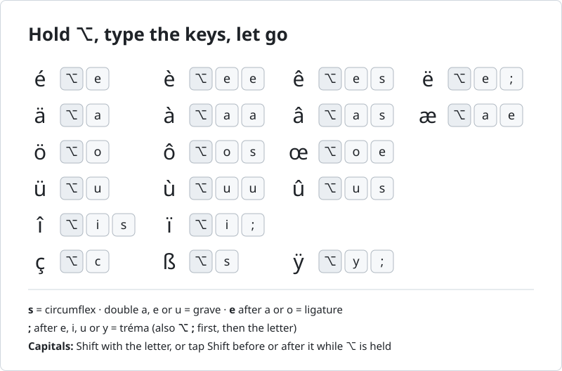

# Arabesque

Arabesque is a macOS input method for typing French and German letters on a US QWERTY keyboard. You hold ⌥ (Option) and type a short sequence of keys.



## Why

On a US keyboard, letters such as é, ç, ü and ß have no key of their own. There are already several ways to type them on a Mac:

- **⌥ dead keys.** On the ABC and U.S. layouts, `⌥e` and then a vowel puts an acute accent on it, `` ⌥` `` a grave accent, `⌥i` a circumflex and `⌥u` an umlaut or tréma. `⌥c`, `⌥s`, `⌥'` and `⌥q` give ç, ß, æ and œ directly. Each accent has its own key, and an accented vowel takes two steps.
- **Press and hold.** Hold a letter key until an accent menu appears, then press a number.
- **U.S. International – PC.** This layout turns `'` `"` `` ` `` `^` and `~` into dead keys, so a plain quote takes the key and then the space bar.
- **French AZERTY or Swiss QWERTZ.** AZERTY swaps A with Q and Z with W and moves M next to L, and QWERTZ swaps Y and Z. Your fingers have to relearn those letters, and shortcuts such as ⌘Z move with them.

Arabesque starts from the letter you mean. Hold ⌥, press the letter, and let the next key choose the accent: the same letter again for the grave (à è ù), s for the circumflex (â ê î ô û), e after a or o for the ligature (æ œ), and `;` after e, i, u or y for the tréma (ë ï ü ÿ). On its own, a, e, o or u gives ä, é, ö or ü, and c and s give ç and ß. Without ⌥, every key types what is printed on it.

If another way already works for you, keep using it.

## How to type

Choose Arabesque in the input menu in the menu bar. While it is on, the menu bar shows Ä. Then hold ⌥, type the keys, and let go.

In this README, ⌥(e s) means hold ⌥, press e, press s, let go of ⌥. In ⌥(e) ⌥(c), you let go of ⌥ between the two keys. A key outside the parentheses is pressed without ⌥.

Hold ⌥ and press a letter on its own, twice, or followed by s, e or `;`. The table shows what you get.

| Letter | On its own | Twice | Then `s` | Then `e` | Then `;` |
|:---:|:---:|:---:|:---:|:---:|:---:|
| `a` | ä | à | â | æ | |
| `c` | ç | | | | |
| `e` | é | è | ê | | ë |
| `i` | | | î | | ï |
| `o` | ö | | ô | œ | |
| `s` | ß | | | | |
| `u` | ü | ù | û | | ü |
| `y` | | | | | ÿ |

So ⌥(e) = é, ⌥(e e) = è, ⌥(o s) = ô, ⌥(o e) = œ and ⌥(i ;) = ï.

**Tréma the other way round.** ⌥(;) shows an underlined ¨. The next key, e, i, u or y, gives ë, ï, ü or ÿ, whether or not you still hold ⌥: ⌥(;) e = ë. Any other key cancels the ¨: ⌥(;) a = a.

**One accented letter per hold.** Keep ⌥ down for all the keys of one letter: ⌥(u s) = û, but ⌥(u) ⌥(s) = üß. Keys after the accented letter type as they do without ⌥: ⌥(c a) = ça. For two accented letters in a row, let go of ⌥ between them: d ⌥(e) ⌥(c) u = déçu.

**Underlined until final.** While you hold ⌥, the new letter is underlined. It becomes final when you let go of ⌥ or press the next key. ⌫ (Delete) or Esc removes it.

**Capitals.** Hold Shift as you press the letter, tap Shift before or after the letter while you hold ⌥, or turn on Caps Lock. Here ⇧e means you hold Shift while you press e, and ⇧ on its own is a tap: press Shift and let go. So ⌥(⇧e), ⌥(⇧ e) and ⌥(e ⇧) all give É. For two-key letters, Shift on either key is enough: ⌥(e ⇧s) = Ê. The capital of ß is ẞ.

**Other letters.** Letters that are not in the table type as they do without ⌥: ⌥(t e) = té. Without ⌥, every key types as on the ABC layout.

**Symbols.** Most digit and punctuation keys type the same ⌥ symbols as on the ABC layout, for example:

| Symbols | Keys |
|---|---|
| « » | `⌥(\)` `⌥(⇧\)` |
| “ ” | `⌥([)` `⌥(⇧[)` |
| ‘ ’ | `⌥(])` `⌥(⇧])` |
| – — | `⌥(-)` `⌥(⇧-)` |
| € | `⌥(⇧2)` |

**Shortcuts.** A ⌘ or ⌃ shortcut, Return, Tab or an arrow key first makes the underlined letter final, then works as usual. With nothing underlined, ⌥⌫ still deletes a word.

The full rules are in [docs/RULES.md](docs/RULES.md), along with the complete [symbol table](docs/RULES.md#symbol-keys) and examples.

## Install, update and uninstall

### Requirements

- macOS 14 or later
- A US QWERTY (ANSI) keyboard
- Command Line Tools for Xcode (`xcode-select --install`) or Xcode, with Swift 6 or later (check with `swift --version`)

### Install

```bash
git clone https://github.com/jinzhuoli0908/arabesque.git
cd arabesque
scripts/install.sh
```

The script builds Arabesque and installs it for your user account. The input method goes into `~/Library/Input Methods`, and its keyboard layout, Arabesque Base, into `~/Library/Keyboard Layouts`. Arabesque uses Arabesque Base in the background, so you do not need to add it as an input source.

After the first install:

1. Log out and back in.
2. Add Arabesque in System Settings › Keyboard › Text Input › Input Sources › Edit… › + › English › Arabesque.
3. Choose Arabesque in the input menu in the menu bar.

### Update

In the `arabesque` folder, run:

```bash
git pull
scripts/install.sh
```

The script ends by telling you what to do next. Usually you switch to another input source and back.

### Uninstall

In the `arabesque` folder, run:

```bash
scripts/uninstall.sh
```

Then log out and back in. This clears Arabesque from the input source list and from app caches.

To remove Arabesque without the script:

1. In System Settings › Keyboard › Text Input › Input Sources › Edit…, select Arabesque and click −.
2. Delete `~/Library/Input Methods/Arabesque.app` and `~/Library/Keyboard Layouts/Arabesque Base.keylayout`. Leave everything else in those folders alone.
3. Log out and back in.

## Privacy

While Arabesque is your input source, macOS sends it your key presses, as it does for any input method. In password fields macOS turns input methods off, so Arabesque does not see what you type there.

Arabesque does not save what you type, does not connect to the network and keeps no log of your keys. In memory it keeps only what it needs for the letter you are typing, such as the underlined letter or a waiting ¨.

You can check this in the code. The input method is built from `Sources/ArabesqueApp`, `Sources/ArabesqueCore` and `Sources/ArabesqueSystem`. This command searches them for network, file, settings and logging calls:

```bash
grep -rnE 'URLSession|NWConnection|Socket|FileManager|FileHandle|UserDefaults|NSLog|os_log|Logger' Sources/ArabesqueApp Sources/ArabesqueCore Sources/ArabesqueSystem
```

It prints one line:

```text
Sources/ArabesqueApp/main.swift:5:    NSLog("Arabesque: Info.plist is missing InputMethodConnectionName")
```

That message is logged only when the app's Info.plist is broken, and the app then quits. It contains nothing you typed.

## FAQ and troubleshooting

**How do I type two accented letters in a row?** Let go of ⌥ between them. One hold types at most one accented letter, so déçu is d ⌥(e) ⌥(c) u.

**Why do I get no accents in Terminal?** In Terminal › Settings › Profiles › Keyboard, turn off "Use Option as Meta key". While it is on, Terminal uses ⌥ as the Meta key for the shell, so Arabesque does not get those keys. With it off, Meta shortcuts such as ⌥B and ⌥F no longer reach the shell.

**When do I need to log out?** After the first install, after you uninstall, and when `scripts/install.sh` says the base layout changed. Sandboxed apps such as Safari keep the old layout until you log out.

**Why does Arabesque do nothing in a password field?** macOS turns input methods off in password fields, so there you type as on a plain US keyboard.

## Contributing

To report a problem or send a pull request, read [CONTRIBUTING.md](CONTRIBUTING.md) first. To ask for another language or keyboard, fill in the [language request form](https://github.com/jinzhuoli0908/arabesque/issues/new?template=language_request.yml).

## License

Arabesque is released under the [MIT License](LICENSE). The base layout, `Resources/Arabesque Base.keylayout`, is generated from Apple's ABC layout.
